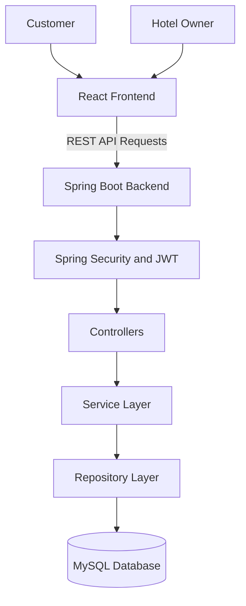
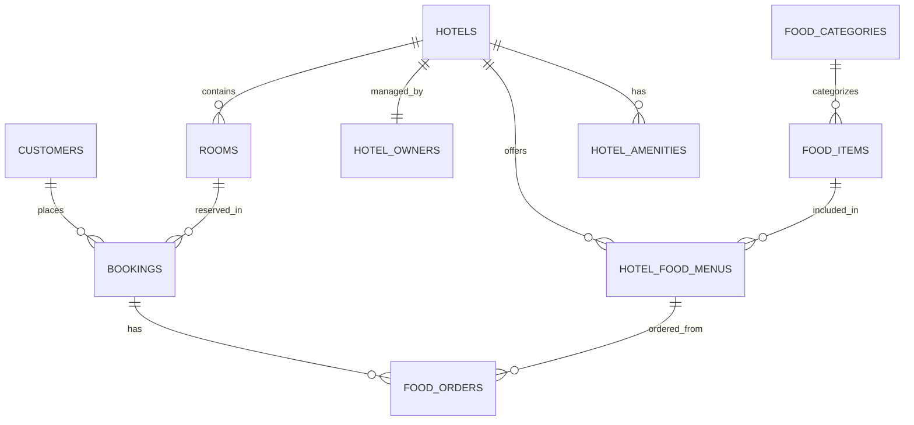
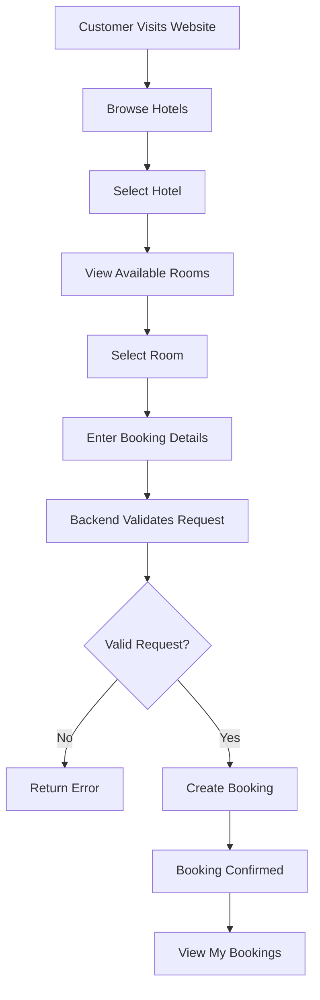
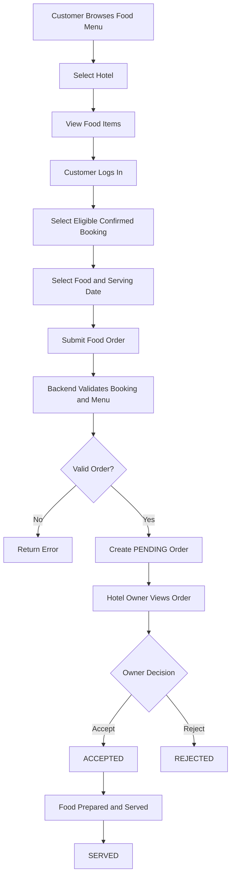

# Royal BNF – System Design

## 1. Project Overview

Royal BNF (Royal Bed and Food) is a hotel booking platform that combines accommodation reservations with hotel-prepared regional food experiences.

The platform allows customers to browse hotels, book rooms, explore hotel food menus and place food orders during their confirmed stay.

Hotel owners can manage food orders associated with their respective hotels.

## 2. Technology Architecture

| Layer | Technology |
|---|---|
| Frontend | React.js, Vite, JavaScript, CSS |
| Backend | Java 17, Spring Boot |
| Database | MySQL 8 |
| ORM | Spring Data JPA, Hibernate |
| Authentication | Spring Security, JWT |
| Password Hashing | BCrypt |
| Build Tools | Maven, npm |

## 3. System Architecture

Royal BNF follows a client-server architecture.



### Architecture Components

**Frontend**
- Provides the user interface.
- Displays hotels, rooms and food menus.
- Supports customer registration, login and booking.
- Provides food ordering and order tracking.
- Provides hotel owner order management.

**Backend**
- Handles REST API requests.
- Implements business logic and validation.
- Manages customer bookings and food orders.
- Controls access through Spring Security and JWT.

**Database**
- Stores customer and hotel information.
- Maintains room and booking records.
- Stores food categories, food items and hotel menus.
- Maintains food orders and their statuses.

## 4. Backend Package Structure

```text
com.royalbnf.backend/
│
├── config/
├── controller/
├── dto/
├── entity/
├── exception/
├── repository/
└── service/
```

| Package | Responsibility |
|---|---|
| config | Application and security configuration |
| controller | Handles HTTP requests and responses |
| dto | Transfers data between frontend and backend |
| entity | Defines database entities |
| exception | Handles application exceptions |
| repository | Performs database operations |
| service | Contains business logic |

## 5. Database Design

The application uses MySQL with Spring Data JPA and Hibernate.

### 5.1 Database Tables

| Table | Purpose |
|---|---|
| customers | Stores customer information |
| hotels | Stores hotel details |
| hotel_owners | Stores hotel owner accounts |
| rooms | Stores hotel room information |
| bookings | Stores customer room reservations |
| food_categories | Stores food categories |
| food_items | Stores food item information |
| hotel_food_menus | Connects food items with hotels and their selling prices |
| food_orders | Stores customer food orders |
| hotel_amenities | Stores hotel amenities as a collection |

### 5.2 Entity Relationships

The following diagram represents the relationships defined in the JPA entity classes.



### 5.3 Important Entity Attributes

**Customer**
- id (Primary Key)
- fullName
- email (Unique)
- password
- phone
- createdAt

**Hotel**
- id (Primary Key)
- name
- location
- description
- createdAt

**HotelOwner**
- id (Primary Key)
- fullName
- email
- password
- phone
- hotel_id (Unique Foreign Key)
- active
- createdAt

**Room**
- id (Primary Key)
- roomNumber
- roomType
- pricePerNight
- capacity
- description
- active
- hotel_id (Foreign Key)
- createdAt

**Booking**
- id (Primary Key)
- guestName
- guestEmail
- guestPhone
- numberOfGuests
- checkIn
- checkOut
- totalPrice
- status
- room_id (Foreign Key)
- customer_id (Foreign Key)
- createdAt

**FoodCategory**
- id (Primary Key)
- name (Unique)
- description
- active
- createdAt

**FoodItem**
- id (Primary Key)
- name
- description
- price
- imageUrl
- vegetarian
- available
- category_id (Foreign Key)
- createdAt

**HotelFoodMenu**
- id (Primary Key)
- hotel_id (Foreign Key)
- food_item_id (Foreign Key)
- sellingPrice
- available
- createdAt

A unique constraint prevents the same food item from being added more than once to the same hotel's menu.

**FoodOrder**
- id (Primary Key)
- booking_id (Foreign Key)
- hotel_food_menu_id (Foreign Key)
- quantity
- servingDate
- specialInstructions
- status
- unitPrice
- totalPrice
- createdAt

### 5.4 Enum Types

**BookingStatus**
- CONFIRMED
- CANCELLED

**FoodOrderStatus**
- PENDING
- ACCEPTED
- REJECTED
- SERVED

## 6. Authentication and Authorization

Royal BNF uses Spring Security and JWT-based authentication.

### Customer Authentication
1. Customer registers using personal details.
2. Password is hashed using BCrypt.
3. Customer logs in using email and password.
4. Backend validates credentials.
5. A JWT token is generated and returned.
6. The frontend uses the token for protected API requests.

### Hotel Owner Authentication
1. Hotel owner logs in using registered credentials.
2. Backend validates the owner account.
3. A JWT token containing the hotel owner role is generated.
4. Protected hotel owner endpoints verify the role.
5. Owners can access orders associated with their own hotel.

## 7. Customer Booking Workflow



Customers can view their reservations and cancel confirmed bookings.

## 8. Food Ordering Workflow



### Food Order Validation

The backend validates:
- The booking exists and belongs to the logged-in customer.
- The booking has CONFIRMED status.
- The selected hotel food menu entry is available.
- The food menu belongs to the same hotel as the booking.
- The serving date is within the booking period.
- The quantity is valid.

The serving date must be on or after check-in and before check-out.

## 9. Security Measures

- Passwords are hashed using BCrypt.
- JWT authentication protects secured endpoints.
