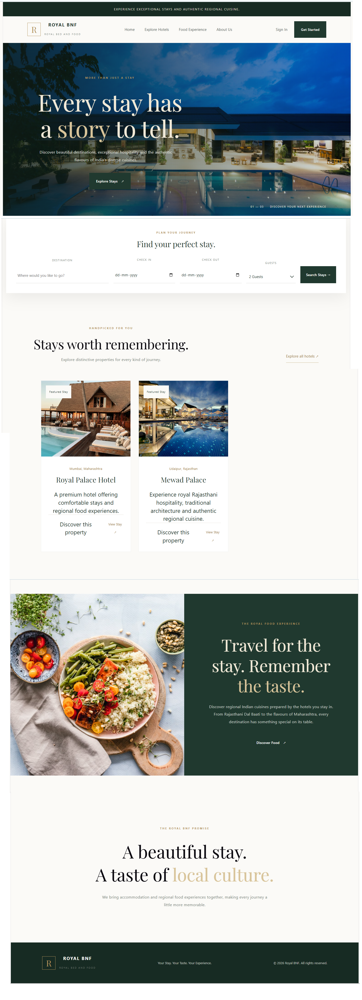

# Royal BNF – Royal Bed and Food

**Your Stay. Your Taste. Your Experience.**

Royal BNF is a hotel booking platform that combines accommodation reservations with authentic regional food experiences. Customers can explore hotels, book rooms, browse hotel food menus and order food during their confirmed stay.

## Features

### Customer
- Customer registration and login
- Browse available hotels and rooms
- View hotel details
- Book rooms and manage reservations
- Explore regional food menus without logging in
- Place food orders with an eligible confirmed booking
- Track food order status and order history

### Hotel Owner
- Secure hotel owner login
- View hotel-specific food orders
- Monitor total, pending, accepted and served orders
- Accept or reject pending orders
- Mark accepted orders as served

### Food Ordering Workflow

`PENDING → ACCEPTED → SERVED`

Orders can also be rejected by the hotel owner.

## Technology Stack

| Layer | Technologies |
|---|---|
| Frontend | React.js, Vite, JavaScript, CSS |
| Backend | Java 17, Spring Boot |
| Database | MySQL 8 |
| ORM | Spring Data JPA, Hibernate |
| Security | Spring Security, JWT, BCrypt |
| Build Tools | Maven, npm |

## Project Structure

```text
RoyalBNF/
├── backend/
│   ├── src/
│   ├── pom.xml
│   └── mvnw
├── frontend/
│   ├── src/
│   ├── public/
│   └── package.json
├── database/
│   └── sample-data.sql
├── screenshots/
├── DESIGN.md
└── README.md
```

## Prerequisites

- Java 17
- Maven (Maven Wrapper is included)
- Node.js and npm
- MySQL 8

## Setup Instructions

### 1. Clone the Repository

```bash
git clone https://github.com/surajnaikwade-cmyk/RoyalBNF.git
cd RoyalBNF
```

### 2. Configure MySQL

Create the database:

```sql
CREATE DATABASE royal_bnf;
```

Configure database credentials and JWT secret as environment variables.

**PowerShell:**

```powershell
$env:DB_USERNAME = "root"
$env:DB_PASSWORD = "your_mysql_password"
$env:JWT_SECRET = "your_base64_encoded_secret"
```

Use your own secure values. Never commit actual credentials or secrets.

### 3. Start the Backend

Open a terminal in the `backend` directory:

```powershell
.\mvnw.cmd spring-boot:run
```

Backend URL: http://localhost:8080

### 4. Start the Frontend

Open another terminal in the `frontend` directory:

```bash
npm install
npm run dev
```

Frontend URL: http://localhost:5173

## Testing

**Backend tests:**

```powershell
.\mvnw.cmd clean test
```

**Frontend production build:**

```bash
npm run build
```

## Security

- Passwords are hashed using BCrypt.
- JWT-based authentication protects secured endpoints.
- Hotel owner endpoints require the hotel owner role.
- Food orders are validated against customer bookings and hotel ownership.
- Database credentials and JWT secrets are supplied through environment variables.

## Screenshots

### Homepage



### Hotel Details and Room Listing


### Food Menu


### My Bookings


### My Food Orders


### Hotel Owner Dashboard


## Future Enhancements

- Online payment integration
- Expanded international cuisine catalogue
- Enhanced hotel and booking search
- Customer reviews and ratings
- Improved hotel owner analytics

## Project Status

Core customer booking, hotel food ordering, customer order history and hotel owner order management functionality have been implemented and tested.

---

**Royal BNF – Royal Bed and Food**

*Your Stay. Your Taste. Your Experience.*